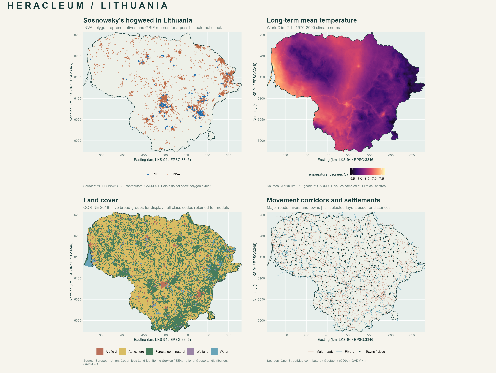

# Местообитания борщевика Сосновского в Литве

Данные и воспроизводимый R-процесс для подготовки моделей распространения **Heracleum sosnowskyi**. Наблюдения INVA объединяются с климатом, рельефом, земным покровом и инфраструктурой на сетке 1 × 1 км.

В репозитории сохранены исходные данные, готовые таблицы и карты. Модель пока не обучалась: это подготовленная основа для следующего этапа исследования.



## Что подготовлено

| Результат | Объём |
|---|---:|
| Записи INVA для нужного вида | 4 962 |
| Используемые полигоны присутствия INVA | 4 753 |
| Записи GBIF для отдельной проверки | 180 |
| Ячейки сетки Литвы | 65 014 |
| Строки в стартовой таблице моделирования | 11 256 |
| Ячейки присутствия / фоновые ячейки | 2 814 / 8 442 |
| Кандидатные предикторы | 64 |
| Карты | 7 отдельных + обзорная, PNG и PDF |

Фоновые ячейки — **не подтверждённые отсутствия**. GBIF хранится отдельно от обучающей выборки; независимость этих наблюдений требует проверки.

## Быстрый старт

Исходные данные и готовые таблицы хранятся через [Git LFS](https://git-lfs.com/). Установите Git LFS, затем загрузите репозиторий:

```sh
git lfs install
git clone https://github.com/makarlozenko/heracleum-sosnowskyi-species-distribution-model.git
cd heracleum-sosnowskyi-species-distribution-model
git lfs pull
```

Откройте **`hogweed.Rproj`** в RStudio. Все команды ниже выполняются из корня проекта.

```r
# Установить один раз, если пакетов ещё нет.
install.packages(c("sf", "terra", "ggplot2", "patchwork", "jsonlite",
                   "DBI", "RSQLite", "curl", "openssl"))

# Сразу открыть готовую таблицу.
d <- read.csv("data/processed/model_table.csv")
d$land_cover_clc <- factor(d$land_cover_clc)
X <- d[readLines("data/processed/predictor_columns.txt")]
y <- d$y
View(d)

# Полностью повторить подготовку данных и построение карт.
source("scripts/02_prepare_and_plot.R", encoding = "UTF-8")
```

Проверено с R 4.2.3, `sf` 1.0-16, `terra` 1.7-71 и `ggplot2` 3.5.1. Полная обработка занимает несколько минут; точные версии пакетов сохранены в [metadata/r_session.txt](metadata/r_session.txt).

Если нужно проверить исходники или восстановить отсутствующие файлы, выполните:

```r
source("scripts/01_download.R", encoding = "UTF-8")
```

Загрузчик использует сохранённые URL и SHA-256, повторно использует проверенные файлы и удаляет временные ZIP после распаковки. Если содержимое источника отличается от сохранённого снимка, выполнение останавливается для проверки.

## Структура

```text
hogweed.Rproj           проект RStudio
scripts/               загрузка, обработка и построение карт
data/raw/              19 исходных файлов без изменений, Git LFS
data/processed/        таблицы признаков и обработанные геометрии
maps/                  карты в PNG и PDF
metadata/              ссылки, контрольные суммы, аудит и сведения о запуске
docs/                  методика и описание источников
```

| Основной файл | Назначение |
|---|---|
| [model_table.csv](data/processed/model_table.csv) | Стартовая выборка присутствие / фон для моделирования |
| [grid_predictors.csv](data/processed/grid_predictors.csv) | Признаки всех ячеек для построения прогнозной карты |
| [predictor_columns.txt](data/processed/predictor_columns.txt) | Список столбцов X без идентификаторов и утечки целевой переменной |
| [cell_occurrence_links.csv](data/processed/cell_occurrence_links.csv) | Связь ячеек с исходными полигонами для пространственной валидации |
| [occurrences.gpkg](data/processed/occurrences.gpkg) | Полигоны и представительные точки INVA, отдельный слой GBIF |
| [run_summary.txt](metadata/run_summary.txt) | Фактические результаты обработки |

## Источники

Снимок данных получен **23 октября 2026 года**. Все преобразования выполняются в R; исходные файлы сохраняются без ручного редактирования.

| Данные | Источник |
|---|---|
| Находки инвазивных видов | [INVA / VSTT](https://data.gov.lt/datasets/4732/) |
| Наблюдения для возможной внешней проверки | [GBIF](https://www.gbif.org/) |
| Месячные климатические нормы и BIO-переменные | [WorldClim 2.1](https://www.worldclim.org/data/worldclim21.html), 1970–2000 |
| Земной покров | [Copernicus / EEA, CORINE 2018](https://land.copernicus.eu/en/products/corine-land-cover/clc2018) |
| Высота | `geodata::elevation_30s("LTU")` |
| Дороги, водотоки, населённые пункты | [OpenStreetMap / Geofabrik](https://download.geofabrik.de/europe/lithuania.html) |
| Граница Литвы | [GADM 4.1](https://gadm.org/data.html) |

Точные ссылки загрузки, вызовы R и условия использования собраны в [docs/SOURCES.md](docs/SOURCES.md). Сведения о каждом скачанном файле находятся в [metadata/downloads.csv](metadata/downloads.csv), а контрольные суммы сохранённых исходников — в [metadata/original_file_integrity.csv](metadata/original_file_integrity.csv). У наборов данных действуют собственные условия использования.

## Перед обучением моделей

Предикторы включают климат, высоту, категории и доли земного покрова, расстояния до дорог, водотоков и поселений. Часть климатических переменных коррелирует; отбор признаков и предобработку нужно выполнять внутри обучающих фолдов.

Для оценки качества используйте пространственное разбиение с учётом `block_id` и связей исходных полигонов. Расстояние до INVA, координаты, идентификаторы и флаги аудита не входят в X. Учитывайте различия дат источников, смещение наблюдений к доступным местам и неполное покрытие OSM за границей страны.

Подробное описание столбцов, обработки геометрий и ограничений — в [docs/METHODOLOGY.md](docs/METHODOLOGY.md).
